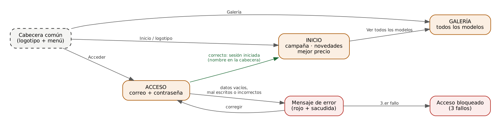

# Prototipo de tienda Polestar — Documentación técnica

| | |
|---|---|
| **Asignatura** | Interfaces de Usuario — Grado en Ingeniería Informática (UMH) |
| **Práctica** | Práctica 1: prototipo de aplicación de escritorio (WPF con Microsoft Blend) |
| **Autor** | Ismael García Grao |
| **Versión** | 0.1 — primera versión generada con ayuda de IA, pendiente de revisión por el alumno |
| **Fecha** | Noviembre de 2026 |

## Índice

0. [Cómo abrir y probar el prototipo](#0-cómo-abrir-y-probar-el-prototipo)
1. [Interpretación de los requisitos y decisiones](#1-interpretación-de-los-requisitos-y-decisiones)
2. [Arquitectura y estructura de la aplicación](#2-arquitectura-y-estructura-de-la-aplicación)
3. [Justificación de las decisiones de diseño](#3-justificación-de-las-decisiones-de-diseño)
4. [Pruebas y comprobaciones](#4-pruebas-y-comprobaciones)
5. [Fuentes, recursos y licencias](#5-fuentes-recursos-y-licencias)
6. [Enlaces públicos y aportación de cada elemento](#6-enlaces-públicos-y-aportación-de-cada-elemento)
7. [Uso de inteligencia artificial](#7-uso-de-inteligencia-artificial)

---

## 0. Cómo abrir y probar el prototipo

**Requisitos:** Windows 10/11, Microsoft Blend para Visual Studio (o Visual Studio) con la carga de trabajo
"Desarrollo de escritorio de .NET" y el SDK de .NET 8 o posterior.

1. Abrir `PolestarPrototipo.sln` desde Blend (*Archivo → Abrir → Proyecto o solución*).
   También se puede abrir directamente `PolestarPrototipo/PolestarPrototipo.csproj`.
2. Compilar y ejecutar con **F5**.
3. Cuenta de demostración para el acceso (datos ficticios, solo existen dentro del prototipo):

   | Correo | Contraseña |
   |---|---|
   | `cliente@polestar.es` | `Polestar2026` |

Herramientas opcionales (necesitan Python 3; la primera, además, Pillow):

```text
python3 herramientas/generar_imagenes.py   # vuelve a crear las imágenes
python3 herramientas/contraste.py          # contraste de colores (WCAG 2.1 AA)
python3 herramientas/verificar_xaml.py     # verificación estática del XAML
dot -Tpng docs/navegacion.dot -o docs/navegacion.png   # diagrama de navegación (Graphviz)
```

---

## 1. Interpretación de los requisitos y decisiones

### 1.1 Objetivo

Polestar quiere vender en España a través de concesionarios. El prototipo representa la aplicación que usará
una tienda de coches para enseñar la gama a sus clientes y para que los clientes accedan a su área privada.
Al ser un **prototipo**, lo importante es la estructura, la navegación, la usabilidad y el cumplimiento de
guías de estilo; los datos, precios e imágenes son ficticios y sustituibles.

### 1.2 De cada requisito a una decisión

| Requisito (enunciado e instrucciones) | Cómo se ha resuelto |
|---|---|
| 3 secciones bien diferenciadas | Tres paneles en la misma ventana: **Inicio**, **Galería** y **Acceso**. Cada uno tiene su propio título y su botón en el menú. |
| Inicio: productos más novedosos, mejor precio, ofertas estacionales y campañas | Banner fijo de la *Campaña de invierno*, sección **Novedades** (3 tarjetas, etiqueta NUEVO) y sección **Mejor precio** (2 tarjetas con precio anterior tachado y etiqueta OFERTA). |
| Acceso: contraseña oculta y gestión de errores simple pero efectiva | `PasswordBox` (muestra puntos), comprobación de campos vacíos, de la `@` y de los puntos del correo, credenciales incorrectas y bloqueo tras 3 fallos. Un único mensaje de error. |
| Galería con todos los productos | 6 tarjetas escritas a mano en un `WrapPanel`. |
| 2 elementos comunes en todas las pantallas: menú y logotipo | La **cabecera** (fila superior de la ventana) está fuera de los paneles, así que es la misma en las tres pantallas. Contiene el logotipo (que también lleva a Inicio) y el menú. Además hay un pie común. |
| Animaciones obligatorias, sin abusar | Solo 3 animaciones cortas (0,3 s, 0,4 s y 0,6 s), cada una con una función concreta. Ver 2.7. |
| Aplicación WPF en Microsoft Blend | Proyecto "Aplicación WPF" (.NET 8). Se abre y edita en Blend. |
| 4 ficheros de código | `App.xaml`, `App.xaml.cs`, `MainWindow.xaml` y `MainWindow.xaml.cs`. |
| Una sola `MainWindow` con 3 paneles uno encima del otro | `ZonaInicio`, `ZonaGaleria` y `ZonaLogin` están en la misma celda de un `Grid`; se cambia su `Visibility`. |
| Menú con `Button` y estilo `BotonMenu`; pantalla activa marcada desde el código con una línea naranja | El estilo dibuja una línea bajo el texto con el color de `BorderBrush`. El método `MostrarPantalla` la pone en `ColorNaranja` en el botón activo y en transparente en los demás. |
| Inicio: banner fijo, Novedades (3) y Mejor precio (2), tarjetas escritas a mano | Hecho así, sin listas enlazadas a datos ni plantillas de datos (más fácil de leer y modificar en Blend). |
| 15 `SolidColorBrush` en App.xaml con los valores indicados | Los 15 colores están en `App.xaml` con un nombre que explica su uso (ver 2.5). En las pantallas nunca se escribe un color en hexadecimal. *El enunciado dice "App.xml"; se ha interpretado como `App.xaml`.* |
| Entre 10 y 15 estilos | 14 estilos (ver 2.5). |
| Imágenes generadas con `generar_imagenes.py` e incluidas como *Resource* | El script crea `logo.png` y 6 `polestar_*.png`. El `.csproj` las incluye con `<Resource Include="Imagenes\*.png" />`, así viajan dentro del `.exe`. |
| Login: comprobar `@` y puntos, un único mensaje de error (campo en rojo con fondo rosado) y `MessageBox` de bienvenida | Método `CorreoBienEscrito`. Una sola zona de error (`ZonaError`) cuyo texto cambia; el campo erróneo se pone con borde `ColorError` y fondo `ColorFondoError`. Si todo es correcto, `MessageBox` de bienvenida. |
| 3 Storyboard en XAML: Entrada (0,3 s), Error (0,4 s), Banner (0,6 s con `EventTrigger`) | `AnimEntrada`, `AnimError` y `AnimBanner` en `Window.Resources`. El banner se lanza con un `EventTrigger` en `Loaded`. |
| Plan de pruebas manual | Apartado 4.2. |
| 3 scripts de Python con nombres y funciones fijados | `herramientas/generar_imagenes.py`, `contraste.py` y `verificar_xaml.py`. |
| Flujo de navegación | `docs/navegacion.dot` y `docs/navegacion.png` (apartado 2.3). |
| Documentación, enlaces públicos y registro de IA | Este documento, el apartado 6 y `docs/registro-ia.md`. |

### 1.3 Interpretaciones y supuestos (decisiones que se pueden discutir)

- **Qué cuenta como "fallo" para el bloqueo.** Solo cuentan los intentos con datos bien escritos pero
  incorrectos. Dejar un campo vacío o escribir mal el correo no gasta intentos: son errores de escritura,
  no intentos de entrar en la cuenta.
- **Mensaje ante datos incorrectos.** Dice "Correo o contraseña incorrectos" sin indicar cuál de los dos
  falla, para no dar pistas a quien pruebe correos ajenos. Por eso se marcan los dos campos.
- **Bloqueo.** Tras 3 fallos se desactivan los campos y el botón. En el prototipo no hay forma de
  desbloquear salvo reiniciar la aplicación; en un producto real lo haría el concesionario.
- **Cerrar sesión.** No aparece en el flujo del enunciado, pero se ha añadido: con la sesión iniciada, el
  botón *Acceder* pasa a *Cerrar sesión* (con confirmación). Sin esto, el usuario no podría salir de su
  cuenta (heurística de control y libertad del usuario).
- **Cuenta de demostración.** No hay base de datos: el correo y la contraseña válidos están en constantes
  del código. Es aceptable en un prototipo, nunca en una aplicación real (ver 3.5).
- **Datos.** Los nombres de modelo se usan porque Polestar es el cliente del encargo; las autonomías,
  precios, colores y ofertas son **ilustrativos** y así se indica en el pie de la aplicación.
- **Versión de .NET.** Se usa `net8.0-windows` porque compila tanto en Visual Studio/Blend 2022 como en
  versiones posteriores. Para usar .NET 10 basta con cambiar `TargetFramework` en el `.csproj`.

---

## 2. Arquitectura y estructura de la aplicación

### 2.1 Organización del proyecto

| Fichero | Qué contiene |
|---|---|
| `PolestarPrototipo/MainWindow.xaml` | Toda la interfaz: cabecera, las 3 pantallas, pie y animaciones |
| `PolestarPrototipo/MainWindow.xaml.cs` | El código: cambiar de pantalla e iniciar sesión |
| `PolestarPrototipo/App.xaml` | Colores y estilos comunes |
| `PolestarPrototipo/Imagenes/` | Logotipo y dibujos de los coches |
| `docs/DOCUMENTACION.md` | Documentación de la práctica (también en PDF en la entrega) |
| `docs/registro-ia.md` | Registro del uso de inteligencia artificial |
| `herramientas/` | Scripts de comprobación (Python, opcionales) |

Ficheros de apoyo que no son código de la aplicación: `PolestarPrototipo/App.xaml.cs` (vacío, lo exige
WPF), `PolestarPrototipo/PolestarPrototipo.csproj` (configuración del proyecto), `PolestarPrototipo.sln`
(solución para abrirlo en Blend), `docs/navegacion.dot` y `docs/navegacion.png` (diagrama de navegación).

### 2.2 Estructura de la ventana

`MainWindow` contiene un `Grid` con tres filas. Las pantallas están **superpuestas en la misma celda** y solo
una es visible:

```text
┌──────────────────────────────────────────────────────────────┐
│ Fila 0  CABECERA (común)   [logo]  Inicio  Galería    Acceder │
├──────────────────────────────────────────────────────────────┤
│ Fila 1  ScrollViewer "ZonaContenido"                         │
│         ┌──────────────────────────────────────────────┐     │
│         │ ZonaInicio   (Visible)                       │     │
│         │ ZonaGaleria  (Collapsed)   ← misma celda      │     │
│         │ ZonaLogin    (Collapsed)                     │     │
│         └──────────────────────────────────────────────┘     │
├──────────────────────────────────────────────────────────────┤
│ Fila 2  PIE (común): aviso de datos ilustrativos             │
└──────────────────────────────────────────────────────────────┘
```

Ventajas de este enfoque para un prototipo: un solo fichero de interfaz, la cabecera y el pie no se repiten,
y cambiar de pantalla es tan simple como cambiar tres propiedades `Visibility`.

### 2.3 Flujo de navegación



- Desde la **cabecera** (presente siempre) se llega a las tres pantallas. El logotipo equivale a *Inicio*.
- Desde **Inicio**, el botón del banner *Ver todos los modelos* lleva a la **Galería**.
- En **Acceso**, si los datos están vacíos, mal escritos o son incorrectos, aparece el **mensaje de error**
  (en rojo y con una sacudida del formulario). El usuario corrige y vuelve a intentarlo.
- Al **tercer fallo** con datos incorrectos el acceso queda **bloqueado**.
- Si los datos son correctos aparece la bienvenida, se vuelve a **Inicio** y la cabecera muestra
  *"Hola, Ana"* y el botón *Cerrar sesión*.

### 2.4 Pantallas y componentes

**Cabecera (común).** Fondo `ColorCabecera`. Logotipo provisional (botón `BtnLogo`), botones de menú
`BtnInicio`, `BtnGaleria` y `BtnAcceder` (estilo `BotonMenu`) y `TxtUsuario`, que solo se ve con la sesión
iniciada. La pantalla activa se marca con una línea naranja bajo su botón.

**Inicio (`ZonaInicio`).**
- *Banner* (`ZonaBanner`): campaña de invierno con antetítulo, título, texto y botón principal. El coche
  entra desde la derecha y el texto desde la izquierda (animación `AnimBanner`).
- *Novedades*: Polestar 5, Polestar 4 y Polestar 3, con etiqueta NUEVO.
- *Mejor precio*: Polestar 2 Single motor y Dual motor, con etiqueta OFERTA, precio anterior tachado y precio
  actual destacado.

**Galería (`ZonaGaleria`).** Título, subtítulo con el número de modelos y 6 tarjetas en un `WrapPanel`:
si la ventana se estrecha, las tarjetas pasan a la fila siguiente en lugar de cortarse.

**Acceso (`ZonaLogin`).** Una tarjeta centrada (`ZonaFormulario`) con:
etiqueta + campo de correo (`TxtCorreo`) con ejemplo de formato debajo, etiqueta + campo de contraseña
(`TxtContrasena`), zona de error (`ZonaError` con `TxtError`, oculta por defecto) y botón *Entrar*
(`BtnEntrar`, que también se activa con la tecla Intro).

**Tarjeta de producto (misma estructura en todo el prototipo).**

```text
┌───────────────────────────┐
│   imagen sobre fondo gris │  ← ImagenTarjeta sobre ColorFondoImagen
├───────────────────────────┤
│ [NUEVO]                   │  ← Etiqueta
│ Polestar 4                │  ← TextoSeccion
│ SUV coupé · 5 plazas      │  ← TextoSecundario
│ Autonomía: hasta 600 km   │  ← TextoNormal
│ Desde 62.900 €            │  ← TextoPrecio
└───────────────────────────┘
```

### 2.5 Colores y estilos (`App.xaml`)

**Colores.** Cada `SolidColorBrush` tiene un nombre que dice para qué sirve, no qué color es; así, si el
cliente cambia su paleta, se edita una sola línea.

| Clave | Valor | Uso |
|---|---|---|
| `ColorFondo` | `#F4F4F2` | Fondo de la ventana |
| `ColorBlanco` | `#FFFFFF` | Tarjetas, campos, texto sobre fondos oscuros |
| `ColorCabecera` | `#121212` | Cabecera |
| `ColorTexto` | `#1A1A1A` | Texto principal; fondo del pie |
| `ColorTextoSecundario` | `#595959` | Textos de apoyo, precio anterior |
| `ColorTextoSobreOscuro` | `#BDBDBD` | Texto secundario en cabecera, banner y pie |
| `ColorAcento` | `#A85400` | Botón principal, precios, etiqueta OFERTA, borde del campo con foco |
| `ColorAcentoOscuro` | `#8A4500` | Botón principal al pasar el ratón o pulsarlo |
| `ColorNaranja` | `#E8862A` | Línea de pantalla activa, menú al pasar el ratón, antetítulo del banner |
| `ColorBorde` | `#D6D6D2` | Bordes de tarjeta; fondo del botón desactivado |
| `ColorBordeCampo` | `#8A8A86` | Borde de los campos de texto |
| `ColorBanner` | `#1E2A33` | Fondo del banner y de la etiqueta NUEVO |
| `ColorFondoImagen` | `#ECECE8` | Fondo de las imágenes de las tarjetas; campo desactivado |
| `ColorError` | `#B3261E` | Texto y bordes de error |
| `ColorFondoError` | `#FCEDEC` | Fondo de la zona de error y de los campos con error |

> **Regla de uso del naranja:** `ColorNaranja` (#E8862A) **no se usa como fondo de texto blanco** porque
> solo alcanza 2,67:1. Para botones y etiquetas con texto blanco se usa `ColorAcento` (#A85400, 5,34:1).

**Estilos (14).**

| # | Clave | Tipo | Para qué |
|---|---|---|---|
| 1 | `TextoTitulo` | TextBlock | Títulos de pantalla y de sección (30 px) |
| 2 | `TextoSeccion` | TextBlock | Nombre del modelo en las tarjetas (20 px) |
| 3 | `TextoNormal` | TextBlock | Texto general (14 px) |
| 4 | `TextoSecundario` | TextBlock | Texto de apoyo; hereda de `TextoNormal` (`BasedOn`) |
| 5 | `TextoPrecio` | TextBlock | Precios en negrita y color de acento |
| 6 | `TextoEtiquetaCampo` | Label | Etiquetas del formulario (permiten Alt+letra) |
| 7 | `Etiqueta` | Border | Distintivos NUEVO / OFERTA |
| 8 | `Tarjeta` | Border | Contenedor de cada producto y del formulario |
| 9 | `ImagenTarjeta` | Image | Altura y escalado común de las imágenes |
| 10 | `BotonMenu` | Button | Botones del menú, con línea inferior y foco visible |
| 11 | `BotonLogo` | Button | Logotipo pulsable y con foco visible |
| 12 | `BotonPrimario` | Button | Acción principal: estados normal, ratón, pulsado, foco y desactivado |
| 13 | `CampoTexto` | TextBox | Campo de texto con borde de foco |
| 14 | `CampoContrasena` | PasswordBox | Igual que `CampoTexto` para la contraseña |

### 2.6 Código subyacente (`MainWindow.xaml.cs`)

| Método | Qué hace |
|---|---|
| `MostrarPantalla(pantalla, botonMenu, titulo, animar)` | Oculta los 3 paneles, muestra el pedido, pone la línea naranja en su botón, cambia el título de la ventana, sube el scroll y lanza `AnimEntrada`. |
| `BtnLogo_Click`, `BtnInicio_Click`, `BtnGaleria_Click`, `BtnVerModelos_Click` | Llaman a `MostrarPantalla` con la pantalla que corresponde. |
| `BtnAcceder_Click` | Sin sesión: muestra Acceso y pone el cursor en el correo. Con sesión: `CerrarSesion`. |
| `BtnEntrar_Click` | Valida en orden: correo vacío → formato del correo → contraseña vacía → credenciales. Si todo es correcto, inicia la sesión. |
| `CorreoBienEscrito(correo)` | Comprueba la `@` y los puntos (ver 3.5). |
| `MostrarError(mensaje, campos...)` | Muestra el único mensaje de error, marca los campos en rojo con fondo rosado, lleva el foco al primero y lanza `AnimError`. |
| `LimpiarError()` | Oculta el mensaje y devuelve los campos a su estilo (`ClearValue`). |
| `BloquearAcceso()` | Desactiva campos y botón tras 3 fallos. |
| `TxtCorreo_TextChanged`, `TxtContrasena_PasswordChanged` | Al escribir de nuevo, el error desaparece. |
| `CerrarSesion()` | Pide confirmación y vuelve al estado sin sesión. |

### 2.7 Animaciones

| Storyboard | Duración | Cómo se lanza | Qué anima | Para qué sirve |
|---|---|---|---|---|
| `AnimEntrada` | 0,3 s | Código: `Begin(pantalla)` en `MostrarPantalla` | Opacidad 0→1 y desplazamiento vertical 12→0 del panel | Confirma que la pantalla ha cambiado |
| `AnimError` | 0,4 s | Código: `Begin(this)` en `MostrarError` | Sacudida horizontal de `ZonaFormulario` | Refuerza el mensaje de error ("no") |
| `AnimBanner` | 0,6 s | XAML: `EventTrigger` `Loaded` en `ZonaBanner` | Entrada del texto (izquierda) y del coche (derecha) | Atrae la atención hacia la campaña |

Las dos animaciones que se lanzan desde el código **no se reproducen** si el usuario ha desactivado las
animaciones en Windows (`SystemParameters.ClientAreaAnimation`). La primera pantalla se muestra sin
`AnimEntrada` para que no coincida con la del banner.

### 2.8 Convención de nombres

Todos los elementos con `x:Name` fuera de las plantillas usan un prefijo:
`Btn` para botones, `Txt` para textos y campos, y `Zona` para paneles y contenedores
(por ejemplo `BtnEntrar`, `TxtCorreo`, `ZonaError`). Así se sabe qué es cada cosa al leer el código, y
`verificar_xaml.py` puede comprobar que todo nombre usado en C# existe en el XAML.

---

## 3. Justificación de las decisiones de diseño

### 3.1 Usabilidad (heurísticas de Nielsen)

| Heurística | Aplicación en el prototipo |
|---|---|
| 1. Visibilidad del estado del sistema | Línea naranja en la pantalla activa; título de la ventana con el nombre de la pantalla; nombre del cliente en la cabecera al iniciar sesión; número de intentos restantes en el error. |
| 2. Relación con el mundo real | Lenguaje de concesionario (*Novedades*, *Mejor precio*, *Desde 62.900 €*, *Antes / Ahora*); formato español de precios. |
| 3. Control y libertad | Menú siempre visible; el logotipo vuelve a Inicio; se puede cerrar sesión (con confirmación). |
| 4. Consistencia y estándares | Una sola tarjeta para todos los productos; mismos colores y estilos en todo; logotipo arriba a la izquierda y acceso arriba a la derecha, como en la mayoría de tiendas. |
| 5. Prevención de errores | Ejemplo de formato bajo el correo; `MaxLength` en los campos; la contraseña se oculta; se ignoran espacios al principio y al final del correo. |
| 6. Reconocer mejor que recordar | Etiquetas siempre visibles (no se usan textos de ayuda dentro del campo que desaparecen al escribir); atajos indicados en los *ToolTip*. |
| 7. Flexibilidad y eficiencia | Atajos Alt+I, Alt+G, Alt+A (menú), Alt+C y Alt+T (campos), Intro para entrar. |
| 8. Diseño estético y minimalista | Paleta sobria (blanco, grises, un acento naranja), una sola acción principal por zona, sin botones decorativos que no hacen nada. |
| 9. Ayudar a reconocer y corregir errores | Mensajes en lenguaje claro que dicen qué pasa y cómo arreglarlo ("Debe tener la forma nombre@dominio.es"). |
| 10. Ayuda y documentación | Ejemplo de formato del correo; *ToolTip* en el menú y el logotipo. |

### 3.2 Accesibilidad (WCAG 2.1)

| Criterio | Aplicación |
|---|---|
| 1.1.1 Contenido no textual | Cada imagen tiene `AutomationProperties.Name` (p. ej. "Dibujo provisional del Polestar 5"). |
| 1.3.1 / 3.3.2 Etiquetas | Cada campo tiene un `Label` visible asociado con `Target` y, además, `AutomationProperties.Name` para que los lectores de pantalla lo anuncien. |
| 1.4.1 Uso del color | El error no se indica solo con rojo: hay un mensaje de texto con un símbolo ⚠. El precio anterior se indica con la palabra "Antes", no solo tachado. |
| 1.4.3 Contraste (AA) | Todas las combinaciones de texto superan 4,5:1 (comprobado con `contraste.py`, ver 4.1). |
| 1.4.11 Contraste no textual | Bordes de campo (3,47:1), línea activa (7,02:1) y anillos de foco superan 3:1. |
| 2.1.1 Teclado | Todo se puede usar con Tab, Intro, Espacio y Alt+letra. Los botones son `Button` reales, no imágenes con clic. |
| 2.3.3 Animaciones | Animaciones cortas y sin parpadeos; las lanzadas desde el código respetan la opción de Windows de desactivar animaciones. |
| 2.4.2 Página con título | El título de la ventana cambia con la pantalla ("Polestar · Galería"). |
| 2.4.7 Foco visible | El foco punteado de WPF no se ve sobre la cabecera negra, así que los estilos dibujan su propio indicador (recuadro blanco en el menú, anillo blanco en el botón principal, borde naranja grueso en los campos). |
| 3.3.1 Identificación de errores | El mensaje dice qué campo falla y el foco se lleva a ese campo. |

### 3.3 Consistencia

- **Interna:** todos los colores salen de `App.xaml` y todos los textos usan uno de los 5 estilos de texto;
  la misma tarjeta se repite en Inicio y Galería; la cabecera y el pie son los mismos en las tres pantallas.
- **Externa:** se siguen convenciones de Windows y de tiendas en línea: logotipo que lleva al inicio,
  botón por defecto que responde a Intro, `MessageBox` estándar para la bienvenida y la confirmación,
  campo de contraseña estándar.

### 3.4 Jerarquía visual

- Tamaños escalonados: título 30 px → nombre del modelo 20 px → texto 14 px → apoyo 13 px.
- En cada tarjeta, el orden de lectura es imagen → etiqueta → nombre → descripción → precio. El precio usa el
  color de acento para que sea lo segundo que se ve tras el nombre.
- En Inicio, el banner ocupa todo el ancho y tiene el único fondo oscuro del contenido: es lo primero que se
  ve. Después vienen Novedades y Mejor precio, en el orden pedido por el cliente.
- En el formulario, el botón *Entrar* ocupa todo el ancho de la tarjeta y es el único elemento de color.

### 3.5 Prevención y gestión de errores

**Validación del correo** (`CorreoBienEscrito`): no puede tener espacios; debe tener exactamente una `@`
con texto antes; la parte de después (el dominio) debe tener al menos un punto, que no puede estar ni al
principio ni al final; no puede haber dos puntos seguidos ni puntos al principio o al final del nombre.

| Ejemplo | Resultado |
|---|---|
| `cliente@polestar.es` | Válido |
| `cliente.polestar.es` | No válido (falta `@`) |
| `cliente@polestar` | No válido (el dominio no tiene punto) |
| `cliente@.es`, `cliente@polestar.` | No válidos (punto al principio o al final del dominio) |
| `cli..ente@polestar.es` | No válido (dos puntos seguidos) |
| `a@b@polestar.es` | No válido (dos `@`) |

**Único mensaje de error:** hay una sola zona (`ZonaError`) y su texto cambia según el caso. Así el usuario
siempre mira al mismo sitio y nunca hay dos mensajes contradictorios a la vez.

| Situación | Mensaje | Campo marcado | ¿Gasta intento? |
|---|---|---|---|
| Correo vacío | Escribe tu correo electrónico. | Correo | No |
| Correo mal escrito | El correo no está bien escrito. Debe tener la forma nombre@dominio.es | Correo | No |
| Contraseña vacía | Escribe tu contraseña. | Contraseña | No |
| Datos incorrectos | Correo o contraseña incorrectos. Te quedan N intento(s). | Ambos | Sí |
| Tercer fallo | Acceso bloqueado tras 3 intentos fallidos… | — (campos desactivados) | — |

**Seguridad del login en el prototipo:** la contraseña se oculta, se borra tras un fallo, el mensaje no
revela qué dato es incorrecto y hay límite de intentos. **Limitación conocida:** la contraseña de la
cuenta de demostración está escrita en el código. En una aplicación real se comprobaría en un servidor y se
guardaría cifrada (*hash*), nunca en el programa.

### 3.6 Feedback

| Acción del usuario | Respuesta de la interfaz |
|---|---|
| Pasar el ratón por el menú | El texto cambia a naranja y el cursor a mano |
| Pasar el ratón por el botón principal | Se oscurece |
| Cambiar de pantalla | Línea naranja, nuevo título de ventana y animación de entrada |
| Dar el foco a un campo | Borde naranja más grueso |
| Error al entrar | Mensaje rojo, campo en rojo con fondo rosado, sacudida y foco en el campo |
| Escribir para corregir | El error desaparece |
| Acceso correcto | `MessageBox` de bienvenida, vuelta a Inicio y "Hola, Ana" en la cabecera |

### 3.7 Diseño centrado en el usuario

Usuarios previstos: **(a)** el personal del concesionario, que enseña la gama al cliente en una pantalla de la
tienda, y **(b)** el cliente que consulta modelos o accede a su cuenta. Necesidades derivadas:

- Ver de un vistazo qué es nuevo y qué está de oferta → secciones separadas con etiquetas de color.
- Comparar modelos → tarjetas iguales con los datos en el mismo orden.
- Usuarios no técnicos → mensajes sin jerga, botones grandes, texto de 14 px o más.
- Pantallas de distinto tamaño → `WrapPanel`, `ScrollViewer` y tamaño mínimo de ventana.

La validación con usuarios reales se hará con las tareas del apartado 4.2.3.

### 3.8 Animaciones: uso y no abuso

Cada animación responde a un cambio de estado (pantalla nueva, error, campaña) y dura como máximo 0,6 s.
No hay animaciones en bucle, ni al pasar el ratón por las tarjetas, ni en el menú, para no distraer ni
retrasar al usuario.

---

## 4. Pruebas y comprobaciones

### 4.1 Comprobaciones automáticas (realizadas durante la generación)

| Comprobación | Herramienta | Resultado |
|---|---|---|
| XML bien formado, recursos, manejadores, nombres y destinos de animación | `verificar_xaml.py` | **OK**, 0 errores en `App.xaml` y `MainWindow.xaml`. |
| Que el verificador detecta errores de verdad | Copia del proyecto con 6 errores provocados (recurso inexistente, manejador renombrado, `TargetName` erróneo, nombre no declarado usado en C#, `FindResource` con clave errónea y etiqueta XML sin cerrar) | Detectó los 6 y terminó con código 1. |
| Contraste de 16 combinaciones de texto | `contraste.py` | **OK**: la más baja es 5,34:1 (blanco sobre `ColorAcento`); mínimo exigido 4,5:1. |
| Contraste de elementos no textuales (6) | `contraste.py` | **OK**: el más bajo es el borde de campo, 3,47:1 (mínimo 3:1). |
| Generación de imágenes | `generar_imagenes.py` | 7 PNG generados y revisados visualmente. |

**Limitación:** el prototipo se generó en Linux, sin Windows. **No se ha compilado ni ejecutado.**
La prueba P01 del plan siguiente es imprescindible.

### 4.2 Plan de pruebas manual

Para cada prueba: seguir los pasos, comparar con el resultado esperado y anotar **OK** o **Fallo** y lo
observado. Si algo falla, anotarlo también en 4.3.

#### 4.2.1 Funcionamiento y navegación

| ID | Qué se prueba | Pasos | Resultado esperado | OK / Fallo | Observaciones |
|---|---|---|---|---|---|
| P01 | Compilación | Abrir la solución en Blend y pulsar F5 | Compila sin errores y se abre la ventana en Inicio | OK | - |
| P02 | Estado inicial | Observar la ventana al abrir | Título "Polestar · Inicio"; línea naranja bajo *Inicio*; el banner entra animado | OK | - |
| P03 | Elementos comunes | Visitar las 3 pantallas | Logotipo, menú y pie iguales y en el mismo sitio en todas | OK | - |
| P04 | Menú → Galería | Pulsar *Galería* | Se ve la galería con 6 tarjetas; línea naranja bajo *Galería*; título "Polestar · Galería"; animación de entrada | OK | - |
| P05 | Menú → Acceso | Pulsar *Acceder* | Se ve el formulario; línea bajo *Acceder*; el cursor está en el campo de correo | OK | - |
| P06 | Logotipo | Desde Galería, pulsar el logotipo | Vuelve a Inicio y la línea pasa a *Inicio* | OK | - |
| P07 | Banner | En Inicio, pulsar *Ver todos los modelos* | Abre la Galería | OK | - |
| P08 | Contenido de Inicio | Revisar Inicio | Banner + 3 tarjetas en Novedades + 2 en Mejor precio con precio anterior tachado | OK | - |
| P09 | Imágenes | Revisar todas las tarjetas | Todas las imágenes se ven (si no, revisar que son *Resource*) | OK | - |
| P10 | Ventana estrecha | Reducir la ventana al mínimo | Las tarjetas bajan de fila, aparece barra de desplazamiento y nada queda cortado | OK | - |
| P11 | Volver arriba | Bajar en Inicio y cambiar a Galería | La Galería se muestra desde arriba | OK | - |

#### 4.2.2 Inicio de sesión

| ID | Qué se prueba | Datos | Resultado esperado | OK / Fallo | Observaciones |
|---|---|---|---|---|---|
| L01 | Todo vacío | Pulsar *Entrar* | "Escribe tu correo electrónico."; correo en rojo con fondo rosado; sacudida; foco en el correo | OK | - |
| L02 | Sin `@` | `cliente.polestar.es` | Mensaje de formato; correo marcado | OK | - |
| L03 | Sin punto en el dominio | `cliente@polestar` | Mensaje de formato | OK | - |
| L04 | Punto al final | `cliente@polestar.` | Mensaje de formato | OK | - |
| L05 | Dos `@` | `a@b@polestar.es` | Mensaje de formato | OK | - |
| L06 | Contraseña vacía | correo válido, sin contraseña | "Escribe tu contraseña."; contraseña marcada | OK | - |
| L07 | Contraseña oculta | Escribir en la contraseña | Solo se ven puntos | OK | - |
| L08 | El error se borra al corregir | Tras L01, escribir en el correo | Desaparece el mensaje y el campo vuelve a su color | OK | - |
| L09 | Datos incorrectos (1.º) | `cliente@polestar.es` / `abc` | "Correo o contraseña incorrectos. Te quedan 2 intento(s)."; ambos campos marcados; contraseña vaciada | OK | - |
| L10 | Datos incorrectos (2.º) | Repetir | "Te quedan 1 intento(s)." | OK | - |
| L11 | Bloqueo (3.º) | Repetir | Mensaje de bloqueo; campos y botón desactivados (grises) | OK | - |
| L12 | Errores de formato no gastan intentos | Reiniciar; 2 fallos de formato y 1 de datos incorrectos | El fallo de datos dice "Te quedan 2 intento(s)" | OK | - |
| L13 | Acceso correcto | Reiniciar; `cliente@polestar.es` / `Polestar2026` | `MessageBox` de bienvenida; vuelve a Inicio; "Hola, Ana" en la cabecera; botón *Cerrar sesión* | OK | - |
| L14 | Mayúsculas y espacios en el correo | ` Cliente@Polestar.es ` / `Polestar2026` | Entra (se ignoran espacios y mayúsculas en el correo) | OK | - |
| L15 | Mayúsculas en la contraseña | `cliente@polestar.es` / `polestar2026` | No entra (la contraseña distingue mayúsculas) | OK | - |
| L16 | Cerrar sesión | Con sesión, pulsar *Cerrar sesión* → *No*, y luego → *Sí* | *No*: nada cambia. *Sí*: desaparece el nombre y vuelve *Acceder* | OK | - |
| L17 | Volver tras un error | Provocar un error, ir a Inicio y volver a *Acceder* | El formulario aparece sin error | OK | El error desaparece siempre y cuando no sea el de bloqueo |

#### 4.2.3 Accesibilidad y usabilidad

| ID | Qué se prueba | Pasos | Resultado esperado | OK / Fallo | Observaciones |
|---|---|---|---|---|---|
| A01 | Solo teclado | Recorrer la aplicación con Tab / Mayús+Tab | El orden es lógico (logo → menú → contenido) y siempre se ve dónde está el foco | OK | - |
| A02 | Atajos | Alt+I, Alt+G, Alt+A; en Acceso, Alt+C y Alt+T | Llevan a cada pantalla / a cada campo | OK | - |
| A03 | Intro | Rellenar el formulario y pulsar Intro | Equivale a pulsar *Entrar* | OK | - |
| A04 | Animaciones desactivadas | Windows: *Configuración → Accesibilidad → Efectos visuales → Efectos de animación* desactivado; reiniciar la app | Cambiar de pantalla y fallar el acceso no producen animación | OK | - |
| A06 | Escalado | Windows al 125 % o 150 % de escala | Todo se ve proporcionado y legible | OK | - |

### 4.3 Problemas encontrados y mejoras aplicadas

Problemas detectados **durante la generación** de esta versión (comprobaciones automáticas y revisión del
diseño y del código):

| # | Problema | Cómo se detectó | Mejora aplicada |
|---|---|---|---|
| 1 | El comando del enunciado `dot navegacion.dot -o navegacion.png` genera un fichero de **texto** (formato dot), no una imagen. | Al ejecutarlo y comprobar el tipo de fichero. | Se usa `dot -Tpng navegacion.dot -o navegacion.png` y se ha corregido el comentario del `.dot`. |
| 2 | Texto blanco sobre `ColorNaranja` (#E8862A) solo alcanza 2,67:1. | Cálculo de contraste al asignar colores. | El naranja claro se reserva para líneas y para texto sobre fondos oscuros; los botones usan `ColorAcento` (5,34:1). |
| 3 | El foco punteado por defecto de WPF no se ve sobre la cabecera negra. | Revisión de accesibilidad de los estilos. | Indicadores de foco propios en `BotonMenu`, `BotonLogo` y `BotonPrimario`. |
| 4 | El coche blanco apenas se distinguía del fondo gris claro de las tarjetas. | Revisión visual de las imágenes generadas. | Contorno más oscuro en todas las siluetas (`generar_imagenes.py`). |
| 5 | Tras un fallo, vaciar la contraseña disparaba `PasswordChanged`, que borraba el mensaje de error recién mostrado. | Revisión del orden de las instrucciones en `BtnEntrar_Click`. | Primero se vacía la contraseña y después se muestra el error. |
| 6 | Un error de una visita anterior seguía visible al volver a Acceso. | Revisión del flujo de navegación. | `BtnAcceder_Click` llama a `LimpiarError` al mostrar el formulario (salvo si está bloqueado). |

## 5. Fuentes, recursos y licencias

| Recurso | Uso en el proyecto | Procedencia | Licencia / condiciones |
|---|---|---|---|
| Microsoft Blend para Visual Studio | Diseño y edición del proyecto | Microsoft | Licencia de Visual Studio (edición Community gratuita para estudiantes) |
| .NET 8 y WPF | Plataforma de la aplicación | Microsoft — <https://github.com/dotnet/wpf> | MIT |
| Plantilla "Aplicación WPF" | Estructura del `.csproj`, `App.xaml` y `MainWindow` | Blend / Visual Studio | Incluida con la herramienta |
| Segoe UI | Tipografía de la interfaz | Fuente del sistema de Windows (no se distribuye con el proyecto) | Licenciada con Windows |
| DejaVu Sans ExtraLight | Texto del logotipo provisional (rasterizado en `logo.png`) | <https://dejavu-fonts.github.io/> | Libre (licencia Bitstream Vera / DejaVu): <https://dejavu-fonts.github.io/License.html> |
| Python 3 | Lenguaje de los 3 scripts | <https://www.python.org/> | PSF License |
| Pillow | Dibujo de las imágenes | <https://python-pillow.org/> | MIT-CMU |
| Graphviz | Diagrama de navegación | <https://graphviz.org/> | Eclipse Public License 1.0 |
| `logo.png` y `polestar_*.png` | Logotipo y fotos de producto **provisionales** | Generados por `generar_imagenes.py` (dibujos originales y genéricos) | Mismas condiciones que el repositorio; no son material oficial |
| Marca y nombres de modelo Polestar | Contexto del encargo | Enunciado de la práctica | Marca registrada de su titular. No se usa su logotipo ni sus fotografías; en la versión final se sustituirían por los oficiales respetando sus condiciones de uso |
| Datos de producto | Autonomías, precios, colores, ofertas | Inventados para el prototipo | Ilustrativos; no son datos oficiales |
| WCAG 2.1 | Criterios de accesibilidad y fórmula de contraste | W3C — <https://www.w3.org/TR/WCAG21/> | Documento público del W3C |
| 10 heurísticas de usabilidad | Justificación de la usabilidad | J. Nielsen — <https://www.nngroup.com/articles/ten-usability-heuristics/> | Referencia bibliográfica |
| Documentación de WPF | Estilos, plantillas, `Storyboard`, `PasswordBox` | Microsoft Learn — <https://learn.microsoft.com/es-es/dotnet/desktop/wpf/> | Documentación pública |
| Claude (Anthropic) | Primera versión del código, scripts y documentación | <https://claude.ai> | Ver `docs/registro-ia.md` |

**Fragmentos de código de terceros:** no se ha copiado código de terceros. Todo el código fue generado por la
IA para este proyecto (ver registro de IA) y debe ser revisado por el alumno.

---

## 6. Enlaces públicos y aportación de cada elemento

Todos los enlaces deben abrirse **sin iniciar sesión**. **[COMPLETAR]** con las URL reales tras publicar.

| Elemento | Enlace público | Aportación |
|---|---|---|
| Repositorio del código | https://github.com/ismaelgarciagrao/practica1_interfaces | Código fuente completo, scripts, imágenes y documentación |
| Documentación | https://github.com/ismaelgarciagrao/practica1_interfaces/blob/main/docs/DOCUMENTACION.md | Este documento |
| Registro de IA | https://github.com/ismaelgarciagrao/practica1_interfaces/blob/main/docs/registro-ia.md | Trazabilidad del uso de IA |
| Imágenes y su generador | https://github.com/ismaelgarciagrao/practica1_interfaces/blob/main/herramientas/generar_imagenes.py | Demuestra que las imágenes son originales y cómo regenerarlas |
| DejaVu (tipografía) | <https://dejavu-fonts.github.io/License.html> | Licencia de la tipografía del logotipo |
| Pillow | <https://python-pillow.org/> | Biblioteca usada para las imágenes |
| Graphviz | <https://graphviz.org/> | Herramienta del diagrama |
| WCAG 2.1 | <https://www.w3.org/TR/WCAG21/> | Norma de accesibilidad aplicada |

**Material no publicable:** ninguno. La cuenta de demostración es ficticia y no hay datos personales.

---

## 7. Uso de inteligencia artificial

Se usó Claude (Anthropic) para generar la primera versión del prototipo y de esta documentación. Las
herramientas, los prompts literales, el material generado, las decisiones que el alumno debe revisar y la
revisión humana están en [`registro-ia.md`](registro-ia.md).
